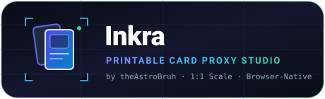

<div align="center">

<!-- Animated SVG logo — card proxy grid & registration marks -->
<a href="https://theastrobruh.github.io/Inkra/">
  
</a>

<br/>

> **Estudio gratuito en el navegador para organizar proxies de cartas coleccionables en cuadrículas listas para imprimir a escala real (1:1) y exportar en PDF. Cero instalaciones, 100% local en tu navegador.**

[](https://github.com/theastrobruh/Inkra/actions)
[](https://theastrobruh.github.io/Inkra/)
[](inkra.html)
[](https://tailwindcss.com/)
[](vendor/jspdf.umd.min.js)
[](LICENSE)
[](https://ko-fi.com/theastrobruh)

<br/>

[**🖨️ Open Inkra**](https://theastrobruh.github.io/Inkra/) · [**🚀 the.astro.os**](https://theastrobruh.github.io/the.astro.os/) · [**🎨 Astro.Studio**](https://theastrobruh.github.io/Astro.Studio/) · [**🎴 CardGram**](https://theastrobruh.github.io/CardGram/) · [**☕ Support the Project**](https://ko-fi.com/theastrobruh)

</div>

---

## ✨ Un Ecosistema: theAstroBruh Universe

**Inkra** forma parte del ecosistema creativo desarrollado por **[theAstroBruh](https://github.com/theastrobruh)**, compartiendo la misma filosofía de ingeniería web: herramientas creativas rápidas, privadas y ejecutadas directamente en el navegador sin dependencias pesadas ni servidores externos.

```
                               ┌───────────────────────────┐
                               │   theAstroBruh Universe   │
                               └─────────────┬─────────────┘
                                             │
     ┌───────────────────────┬───────────────┴───────────────┬───────────────────────┐
     ▼                       ▼                               ▼                       ▼
the.astro.os           Astro.Studio                      CardGram                  Inkra
Web Desktop OS     Photo & Color Studio               3D Card Showcase       Card Proxy Studio
```

---

## 🛠️ Características principales

| | Módulo | Detalles |
|---|---|---|
| 🔍 | **Búsqueda Online de Cartas** | Busca cartas directamente en **Magic: The Gathering**, **Pokémon TCG**, **Yu-Gi-Oh!** y **Disney Lorcana** sin salir de la app. |
| 🖼️ | **Carga Local y URLs** | Sube múltiples imágenes (**PNG, JPG, WEBP**) o pega una URL directa cuando la carta no esté en las bases de datos. |
| 📐 | **Escala Real 1:1** | Presets exactos para **Cardfight!! Vanguard**, **Yu-Gi-Oh!**, **Pokémon / Magic / Lorcana**, **Tarot**, **Mini Euro** y medidas personalizadas. |
| 📄 | **Exportación PDF Real** | Genera un PDF a tamaño real con las imágenes incrustadas (sin depender de sitios externos), listo para USB, compartir o imprimir. |
| ✂️ | **Guías de Corte y Formatos** | Marcas de corte opcionales para cada carta y soporte para **A4, Letter, Legal y A3** en vertical u horizontal. |
| 🌐 | **Multilenguaje & Privado** | Interfaz en **English, Español y Deutsch**, con controles de duplicar/eliminar por carta y ejecución 100% en tu navegador. |

---

## 🖨️ Consejos de impresión

| Ajuste | Valor recomendado |
|---|---|
| Escala | **100% / Tamaño real** |
| Márgenes | **Ninguno (None)** |
| Gráficos de fondo | **Activados** |
| Tamaño de papel | Igual al seleccionado en Inkra |

> Para obtener el resultado más predecible al imprimir desde otra PC o llevar el archivo en USB, usa **Download PDF**: el PDF se genera con las dimensiones físicas exactas e incrusta todas las imágenes.

---

## 🃏 Fuentes de datos de cartas

| Juego | API |
|---|---|
| Magic: The Gathering | [Scryfall API](https://scryfall.com/docs/api) |
| Pokémon TCG | [Pokémon TCG API](https://docs.pokemontcg.io/) |
| Yu-Gi-Oh! | [YGOPRODeck API](https://ygoprodeck.com/api-guide/) |
| Disney Lorcana | [Lorcana API](https://lorcana-api.com/) |

Los nombres, imágenes y datos de cada juego pertenecen a sus respectivos propietarios. Inkra es únicamente una herramienta de maquetación para impresión personal de proxies.

---

## 💻 Uso local y desarrollo

No hay paso de compilación (*build step*). Abre `inkra.html` en cualquier navegador moderno (el motor PDF está incluido en `vendor/jspdf.umd.min.js`).

```
├── inkra.html              # Aplicación completa (HTML + CSS + JS autocontenido)
├── index.html              # Punto de entrada para GitHub Pages (redirige a inkra.html)
├── assets/
│   ├── icon.svg            # Ícono / favicon de la app
│   └── readme/
│       └── inkra-logo.svg  # Logo SVG animado del README
├── vendor/
│   └── jspdf.umd.min.js    # Motor PDF local
└── .github/workflows/
    └── deploy.yml          # GitHub Actions — despliegue automático a GitHub Pages
```

---

## 🚀 Despliegue en GitHub Pages

1. Sube el proyecto a GitHub en la rama `main`.
2. En **Settings → Pages**, selecciona **Source: GitHub Actions**.
3. Cada `push` a `main` desplegará automáticamente la raíz del repositorio en `https://<usuario>.github.io/Inkra/`.

---

## 📄 Licencia

MIT © 2026 [theAstroBruh](https://github.com/theastrobruh) — Libre para usar y modificar.
